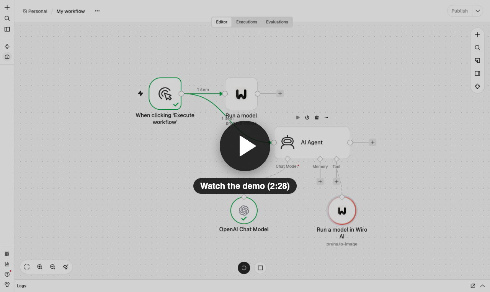
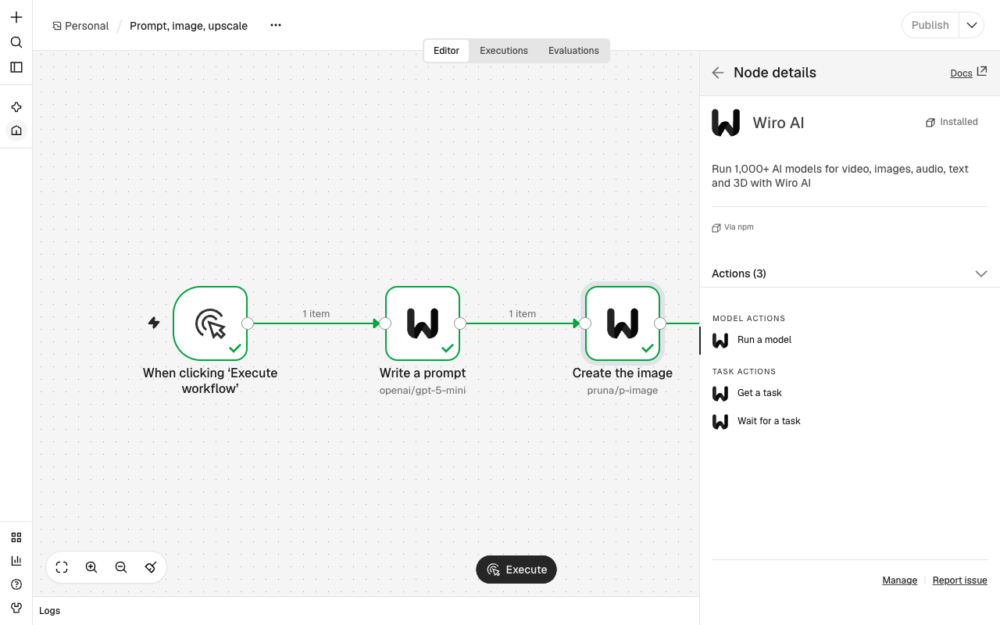
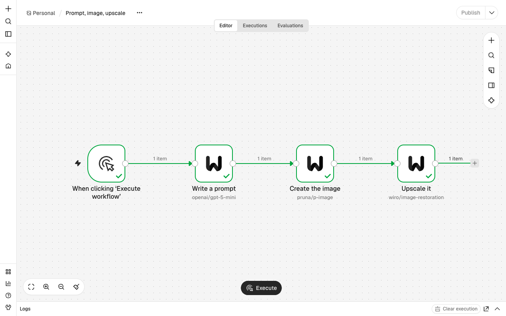
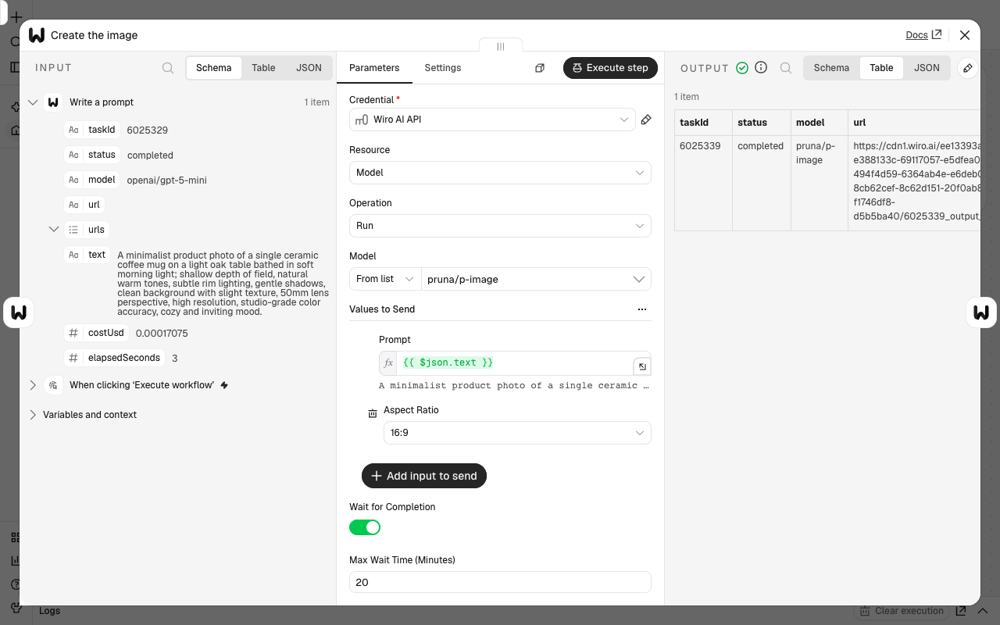

<div align="center">


# n8n-nodes-wiro: Wiro AI for n8n

One n8n node for every Wiro AI model: generate video, images, speech and music, chat with LLMs, edit and upscale images, and create 3D models inside your [n8n](https://n8n.io) workflows.

[](https://www.npmjs.com/package/@wiro-ai/n8n-nodes-wiro) [](https://n8n.io/integrations/wiro-ai/) [](https://docs.n8n.io/integrations/community-nodes/) [](LICENSE.md)

[Website](https://wiro.ai) · [n8n integration](https://n8n.io/integrations/wiro-ai/) · [Models](https://wiro.ai/models) · [Docs](https://wiro.ai/docs) · [Dashboard](https://wiro.ai/panel)


</div>

The **Wiro AI** node runs any of the 1,000+ models on [Wiro AI](https://wiro.ai/models) through the Wiro REST API. Pick a model from a searchable list and its inputs load into the node with their default values, so the same node handles text to video, image editing, speech, music, LLM chat, upscaling and 3D. It also works as a tool for the n8n AI Agent.

---

## Demo

[](https://cdn.jsdelivr.net/gh/wiroai/n8n-nodes-wiro@22a1593/.github/assets/wiro-ai-n8n-demo.mp4)

[Watch the two-and-a-half-minute demo](https://cdn.jsdelivr.net/gh/wiroai/n8n-nodes-wiro@22a1593/.github/assets/wiro-ai-n8n-demo.mp4). It installs the package from npm in n8n, adds a Wiro AI API credential and tests it, runs `pruna/p-image` with the Wiro AI node, then has an AI Agent call the same node as a tool.

---

## Screenshots

The node and its actions in the n8n node panel:



A workflow where three Wiro AI nodes write a prompt, create the image and upscale it:



The image step: the prompt from the step before, the model's inputs and the output with the image URL:



---

## Installation

The Wiro AI node is verified by n8n: [n8n.io/integrations/wiro-ai](https://n8n.io/integrations/wiro-ai/). An instance owner can find **Wiro AI** in the nodes panel of the workflow editor and install it, on n8n Cloud and on self-hosted instances that show verified community nodes. After that, everyone on the instance can add it to their workflows.

On a self-hosted n8n instance, an Owner or Admin can also go to **Settings > Community Nodes**, select **Install**, enter `@wiro-ai/n8n-nodes-wiro`, accept the risk notice and select **Install**. The [n8n community nodes guide](https://docs.n8n.io/integrations/community-nodes/installation/) covers the other install methods.

For a manual install (for example inside a Docker container), run this in `~/.n8n/nodes` and restart n8n:

```bash
npm install @wiro-ai/n8n-nodes-wiro
```

---

## Credentials

1. Sign up at [wiro.ai](https://wiro.ai) and create a project at [wiro.ai/panel/project/new](https://wiro.ai/panel/project/new).
2. In n8n, go to **Credentials > Add new > Wiro AI API**.
3. Enter the project's **API Key**. If the project uses signature authentication, also enter its **API Secret**: the node then signs every request with HMAC-SHA256, so the secret itself is never sent.

Runs are billed to the wallet of the project's workspace. See [Authentication](https://wiro.ai/docs/authentication) in the Wiro docs.

---

## Operations

| Resource | Operation | What it does |
| --- | --- | --- |
| Model | Run | Runs a model with your inputs, waits for the task and returns its outputs |
| Task | Get | Reads a task by its ID, with its status and outputs |
| Task | Wait | Waits until a task finishes, then returns its outputs |

### Model > Run

- **Model:** pick it **From List** (search by name), paste its wiro.ai link (**By URL**, for example `https://wiro.ai/models/pruna/p-image`) or enter it **By Slug** (`pruna/p-image`).
- **Inputs:** the model's inputs load with their defaults. Required inputs are always shown. Advanced ones start hidden; add them with **Add input to send**. Inputs you leave out use the model's defaults.
  - File inputs take public URLs. When an input takes several files, separate the URLs with commas.
  - To feed one step into the next, map a field from the step before, for example `{{ $json.url }}` or `{{ $json.text }}`.
- **Wait for Completion** (on by default) waits for the task and returns its outputs. Turn it off to get the task ID at once and read the task later with **Task > Get** or **Task > Wait**.
- **Max Wait Time (Minutes)** (20 by default, up to 120): a task still running after this time comes back with status `running`. Read it later with **Task > Wait** and the same task ID instead of starting it again.

### Task > Get and Task > Wait

Both take a **Task ID**, the `taskId` field of a Wiro AI node's output.

---

## Output

| Field | What it holds |
| --- | --- |
| `taskId` | The ID of the Wiro task |
| `status` | `queued`, `running`, `completed`, `failed` or `cancelled` |
| `model` | The model, as `owner/model` |
| `url` | The first output file |
| `urls` | Every output file |
| `text` | The reply of a text model |
| `costUsd` | What the task cost, in US dollars |
| `elapsedSeconds` | How long the task ran |

A task that fails or is cancelled stops the node with an error. To handle it in its own branch, set the node's **On Error** setting to **Continue (using error output)**.

---

## Example workflow

Copy this JSON and paste it into an n8n workflow. Then select your Wiro AI API credential on the two Wiro AI nodes.

```json
{
  "nodes": [
    {
      "name": "When clicking ‘Execute workflow’",
      "type": "n8n-nodes-base.manualTrigger",
      "typeVersion": 1,
      "position": [0, 0],
      "parameters": {}
    },
    {
      "name": "Write a prompt",
      "type": "@wiro-ai/n8n-nodes-wiro.wiro",
      "typeVersion": 1,
      "position": [260, 0],
      "parameters": {
        "resource": "model",
        "operation": "run",
        "model": { "__rl": true, "mode": "id", "value": "openai/gpt-5-mini" },
        "inputs": {
          "mappingMode": "defineBelow",
          "value": { "prompt": "Write one image prompt for a product photo of a ceramic coffee mug. Reply with the prompt only." },
          "matchingColumns": [],
          "schema": []
        }
      }
    },
    {
      "name": "Create the image",
      "type": "@wiro-ai/n8n-nodes-wiro.wiro",
      "typeVersion": 1,
      "position": [520, 0],
      "parameters": {
        "resource": "model",
        "operation": "run",
        "model": { "__rl": true, "mode": "id", "value": "pruna/p-image" },
        "inputs": {
          "mappingMode": "defineBelow",
          "value": { "prompt": "={{ $json.text }}", "aspectRatio": "16:9" },
          "matchingColumns": [],
          "schema": []
        }
      }
    }
  ],
  "connections": {
    "When clicking ‘Execute workflow’": { "main": [[{ "node": "Write a prompt", "type": "main", "index": 0 }]] },
    "Write a prompt": { "main": [[{ "node": "Create the image", "type": "main", "index": 0 }]] }
  }
}
```

---

## Use with the AI Agent

The node is marked `usableAsTool`, so you can attach it to an n8n **AI Agent** as a tool and let the agent run the model you set.

---

## Agent skill

This repository includes an agent skill, `wiro-n8n`, in [`skills/wiro-n8n/SKILL.md`](./skills/wiro-n8n/SKILL.md). It shows coding agents such as Claude Code, Codex and Cursor how to build n8n workflows with the Wiro AI node: install, credentials, picking a model, outputs, errors and cost control. Install it with:

```bash
npx skills add wiroai/n8n-nodes-wiro --skill wiro-n8n
```

---

## Compatibility

Needs n8n 1.85.0 or later, the first release with `NodeConnectionTypes`, which the node imports. Tested on n8n 2.46.7. The package has no runtime dependencies.

---

## Resources

- [Wiro AI models](https://wiro.ai/models)
- [Run a model](https://wiro.ai/docs/run-a-model), [Tasks](https://wiro.ai/docs/tasks) and [Model parameters](https://wiro.ai/docs/model-parameters) in the Wiro docs
- [n8n community nodes](https://docs.n8n.io/integrations/community-nodes/)
- Support: [support@wiro.ai](mailto:support@wiro.ai)

---

## More from Wiro AI

| Repository | What it is |
| --- | --- |
| [Wiro-MCP](https://github.com/wiroai/Wiro-MCP) | Official MCP server for Wiro AI, [`@wiro-ai/wiro-mcp` on npm](https://www.npmjs.com/package/@wiro-ai/wiro-mcp) |
| [Wiro-LLM](https://github.com/wiroai/Wiro-LLM) | Vercel AI SDK provider for chat, images, speech, transcription and video, [`@wiro-ai/wiro-llm` on npm](https://www.npmjs.com/package/@wiro-ai/wiro-llm) |
| [Wiro-Chromium-Extension](https://github.com/wiroai/Wiro-Chromium-Extension) | Wiro AI extension for Chrome, Edge, Opera and Brave |
| [Wiro-Firefox-Extension](https://github.com/wiroai/Wiro-Firefox-Extension) | Wiro AI add-on for Firefox |
| [Wiro-Safari-Extension](https://github.com/wiroai/Wiro-Safari-Extension) | Wiro AI extension for Safari on the Mac |
| [Wiro-Plugin](https://github.com/wiroai/Wiro-Plugin) | Wiro AI plugin for Cursor, Claude Code, Gemini CLI, Devin, Antigravity and Kiro |
| [Wiro-Skills](https://github.com/wiroai/Wiro-Skills) | Agent skills for images, image edits, video, music, speech, transcripts, 3D and model search |
| [Swift-QuickStart](https://github.com/wiroai/Swift-QuickStart) | WiroKit, the Wiro AI SDK for iOS |
| [Kotlin-QuickStart](https://github.com/wiroai/Kotlin-QuickStart) | WiroKit, the Wiro AI SDK for Android |
| [Dart-QuickStart](https://github.com/wiroai/Dart-QuickStart) | Wiro AI SDK for Dart and Flutter, [`wiro` on pub.dev](https://pub.dev/packages/wiro) |
| [ReactNative-QuickStart](https://github.com/wiroai/ReactNative-QuickStart) | Wiro AI SDK for React Native and Expo, [`@wiro-ai/wiro-react-native` on npm](https://www.npmjs.com/package/@wiro-ai/wiro-react-native) |
| [Swift-Realtime](https://github.com/wiroai/Swift-Realtime) | Realtime voice AI example for iOS |
| [Kotlin-Realtime](https://github.com/wiroai/Kotlin-Realtime) | Realtime voice AI example for Android |
| [Dart-Realtime](https://github.com/wiroai/Dart-Realtime) | Realtime voice AI example for Flutter |
| [ReactNative-Realtime](https://github.com/wiroai/ReactNative-Realtime) | Realtime voice AI example for React Native |
| [Wiro-Dify-Plugin](https://github.com/wiroai/Wiro-Dify-Plugin) | Wiro AI plugins for Dify: the LLM gateway as a model provider, plus image, video, speech and music tools |
| [Wiro-ComfyUI](https://github.com/wiroai/Wiro-ComfyUI) | Wiro AI nodes for ComfyUI |
| [Wiro-Hermes](https://github.com/wiroai/Wiro-Hermes) | Wiro AI plugins for Hermes Agent: image, video, audio and 3D tools, plus the LLM gateway as a model provider |
| [Wiro-Zed](https://github.com/wiroai/Wiro-Zed) | Wiro AI MCP server extension for Zed |
| [Wiro-Action](https://github.com/wiroai/Wiro-Action) | GitHub Action for Wiro AI models and the LLM gateway, [on the GitHub Marketplace](https://github.com/marketplace/actions/wiro-ai-action) |
| [Wiro-Raycast](https://github.com/wiroai/Wiro-Raycast) | Wiro AI extension for Raycast: image and video generation, LLM chat and model search |
| [Wiro-WordPress](https://github.com/wiroai/Wiro-WordPress) | Wiro AI plugin for WordPress: featured images, image edits, alt text, narration and SEO suggestions |
| [Wiro-Obsidian](https://github.com/wiroai/Wiro-Obsidian) | Wiro AI plugin for Obsidian: images, video, speech, music, transcription and text tools |
| [Wiro-Blender](https://github.com/wiroai/Wiro-Blender) | Wiro AI add-on for Blender: text to 3D, image to 3D and textures |
| [Wiro-Figma](https://github.com/wiroai/Wiro-Figma) | Wiro AI plugin for Figma: images, vectors, image edits and text |
| [Wiro-Next-Starter](https://github.com/wiroai/Wiro-Next-Starter) | Next.js starter for Wiro AI: Playground, image, video and audio tools, and LLM chat, ready for Vercel and Railway |
| [Wiro-Docs](https://github.com/wiroai/Wiro-Docs) | Source of the Wiro AI API docs |
| [wiroai.github.io](https://wiroai.github.io) | Every open-source project from Wiro AI on one page, with a page for each repository |

[Website](https://wiro.ai) · [Models](https://wiro.ai/models) · [Docs](https://wiro.ai/docs) · [X](https://x.com/wiroai)

---

## License

[MIT](LICENSE.md)
